# HRAS System Diagrams

These diagrams show how HRAS (Human Rights Advisory System) is built, how a question becomes an answer, and where the data lives.

Each diagram comes in two forms:

- **SVG image**: shown on this page. It follows your light or dark theme.
- **Interactive HTML**: open it in a browser. You can focus a component, trace its connections, follow the source links into the code, and export PNG, SVG or WebM.

All diagrams are built with [Archify](https://github.com/tt-a1i/archify) from the JSON files in [`diagrams/source/`](./diagrams/source/). Every component cites the code it describes, pinned to commit `84e983f`.

---

## 1. System architecture

The main path of a chat request, from the officer's browser to the language model, and the stores the agents read.


[Open the interactive diagram](./diagrams/01-system-architecture.html)

Things the picture does not say on its own:

- Both services run on Cloudflare. The frontend is a Next.js Worker (OpenNext). The backend Worker forwards every request to one container (`max_instances: 1`), which sleeps after 30 minutes without traffic.
- The browser calls the API directly, using `NEXT_PUBLIC_API_URL`. The frontend Worker serves only the app.
- If the agent graph raises an error, `ChatService` answers with the single RAG chain instead.
- Chat history stays in the container's memory. The conversations API needs `USE_POSTGRES=true`.

---

## 2. Chat request sequence

What happens, step by step, when someone asks a research question. This is the most common route.


[Open the interactive diagram](./diagrams/02-chat-request-sequence.html)

A research question makes three LLM calls: the Supervisor classifies it, the Research agent summarises what it found, and the Advisory agent writes the answer. A compare question goes through the Compare agent instead of Research. An advisory question goes straight to the Advisory agent, with no retrieval.

If the vector store is empty, the request stops at the first check. The reply tells you to run ingestion.

---

## 3. Conversation storage schema

The relational tables that hold saved conversations.


[Open the interactive diagram](./diagrams/03-conversation-erd.html)

| Table | Column | Type | Description |
|-------|--------|------|-------------|
| **conversations** | id | VARCHAR(36) | Primary key (UUID string) |
| | title | VARCHAR(255) | First 50 characters of the opening question |
| | created_at | TIMESTAMPTZ | Creation time |
| | updated_at | TIMESTAMPTZ | Last update (set on change) |
| **messages** | id | VARCHAR(36) | Primary key |
| | conversation_id | VARCHAR(36) (FK) | References `conversations.id`, cascade delete |
| | role | VARCHAR(20) | `user` or `assistant` |
| | content | TEXT | Message text |
| | created_at | TIMESTAMPTZ | Creation time |
| **message_sources** | id | VARCHAR(36) | Primary key |
| | message_id | VARCHAR(36) (FK) | References `messages.id`, cascade delete |
| | country | VARCHAR(100) | Country name |
| | mechanism | VARCHAR(100) | UPR, CERD, CAT and so on |
| | year | VARCHAR(10) | Document year |
| | theme | VARCHAR(255) | Human rights theme |
| | status | VARCHAR(50) | Recommendation status |
| | snippet | TEXT | Document excerpt |

The tables use `DATABASE_URL` (SQLite by default). Vectors are not stored here. They live in ChromaDB or Cloudflare Vectorize.

---

## 4. Multi-agent workflow

How the LangGraph supervisor routes a question to the specialist agents.


[Open the interactive diagram](./diagrams/04-multi-agent-workflow.html)

| Agent | Role | Key actions |
|-------|------|-------------|
| **Supervisor** | Classifier and router | Asks the LLM (temperature 0) for `query_type`, countries and themes. Routes to Compare when `requires_comparison` is true or the type is `compare`, to Advisory for `advisory`, and to Research for everything else, including a reply it cannot parse. |
| **Research** | Retrieval and summary | Runs a vector search (k=8), then a country-filtered search (5 per country). Keeps the top 10 records as citations and summarises them. |
| **Compare** | Cross-country analysis | Calls `compare_countries` (5 records per country), or a general search (k=10) when no countries were found. Writes a comparison. |
| **Advisory** | Final answer | Combines the research summary or comparison with the top sources and writes the final UN-style response. |

---

## 5. Data ingestion pipeline

How UHRI recommendations become searchable vectors.


[Open the interactive diagram](./diagrams/05-data-ingestion-pipeline.html)

Ingestion runs in two cases:

1. You call `POST /api/v1/admin/ingest`. Pass `clear_existing: true` to empty the store first.
2. The backend starts with `AUTO_INGEST_ON_EMPTY=true` and finds the store empty. It then seeds the sample data in the background. This is the default on Cloudflare.

| Parameter | Value | Notes |
|-----------|-------|-------|
| Unit of storage | One vector per UHRI record | Records are short, so they are not chunked |
| Metadata | country, mechanism, cycle, year, theme, status, recommending_state | Used by the agent tools as filters |
| Embedding model | `@cf/baai/bge-small-en-v1.5` on Cloudflare | Locally, any OpenAI-compatible embeddings endpoint |
| Vector dimension | 384 on Cloudflare | Changing the model means a full re-ingestion |
| Collection | `uhri_recommendations` (ChromaDB) or `hras-uhri` (Vectorize) | Set by `VECTOR_STORE_BACKEND` |

---

## 6. API layer

The middleware every request passes through, in order, and the route groups behind the router.



[Open the interactive diagram](./diagrams/06-api-architecture.html)

Starlette runs the last middleware added first, so CORS sees each request before the others. Trusted-host checking runs only when `APP_ENV=production`.

| Endpoint | Method | Description |
|----------|--------|-------------|
| `/health` | GET | Health check and readiness probe |
| `/health/detailed` | GET | Health of each dependency |
| `/api/v1/chat` | POST | Answer a question through the agent workflow |
| `/api/v1/admin/ingest` | POST | Load UHRI records into the vector store |
| `/api/v1/admin/stats` | GET | Vector store name and document count |
| `/api/v1/conversations` | GET | List saved conversations (needs `USE_POSTGRES`) |
| `/api/v1/conversations/{id}` | GET, DELETE | Get or delete one conversation (needs `USE_POSTGRES`) |
| `/metrics` | GET | Prometheus metrics |

---

## Updating a diagram

1. Edit the JSON file in `diagrams/source/`. Update `meta.repository.revision` if you cite newer code.
2. Run Archify's `finalize` command from the repository root:

   ```bash
   node <archify>/bin/archify.mjs finalize <type> \
     docs/architecture/diagrams/source/<file>.json \
     docs/architecture/diagrams/<name>.html \
     --repo-root . --quality showcase
   ```

3. Open the HTML file, choose **Export → SVG**, and save it over `diagrams/<name>.svg`.

## File locations

```
docs/architecture/diagrams/
├── 01-system-architecture.{html,svg}
├── 02-chat-request-sequence.{html,svg}
├── 03-conversation-erd.{html,svg}
├── 04-multi-agent-workflow.{html,svg}
├── 05-data-ingestion-pipeline.{html,svg}
├── 06-api-architecture.{html,svg}
└── source/          # Archify JSON for each diagram
```

---

## Related documentation

- [Architecture Overview](./ARCHITECTURE.md): detailed system architecture
- [AI/ML Pipeline](./AI_ML.md): RAG and multi-agent details
- [API Reference](../reference/API.md): REST endpoint documentation
- [User Guide](../getting-started/USER_GUIDE.md): how to use the app
